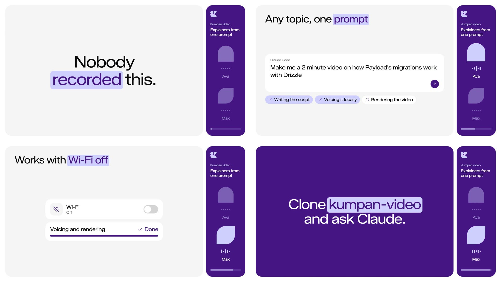

# Kumpan video



Ask Claude for a video and get an MP4. Two hosts talk a topic through while slides, diagrams, code and terminal output build up beside them, in Kumpan's purple, type and spring.

It all runs on your Mac. Claude writes the script, [Kokoro](https://huggingface.co/hexgrad/Kokoro-82M) voices it on Apple Silicon, a few lines of numpy make the music and sound effects, and [Remotion](https://www.remotion.dev) renders it frame by frame. Nobody records anything, there's no voice or music service to pay for, and the script never leaves the machine.

## Setup

```bash
brew install uv ffmpeg
npm install
uv sync
```

Needs an Apple Silicon Mac. The first run downloads the voice model (330 MB); after that, voicing and rendering work with the Wi-Fi off.

## Make a video

Open the folder in Claude Code and say what you want:

> Make a five minute video that explains our deploy pipeline from ../infra/README.md

> Turn every page in ../handbook into an episode

> Cut a 30 second trailer for the new booking flow

Claude writes the script, checks it, voices it and opens it in Remotion Studio so you can watch along. Ask for changes in plain words. Edited lines are the only ones voiced again, so a fix takes seconds. When it looks right, Claude renders `courses/<course>/out/<episode>.mp4` with a subtitle track you can switch on, plus an `.mp3` of just the voices and an `.srt`. Ask for a vertical version too and you also get a 1080×1920 cut for phones.

## By hand

```bash
uv run tts.py <course> <episode>   # voice a script
npm run studio                     # watch every voiced episode
./build.sh <course> <episode>      # render the .mp4 and .mp3
```

The script format, the visuals and the writing rules are in `CLAUDE.md`.

## Good to know

- The voices speak English. Kokoro has no Swedish.
- Remotion is free for companies of up to three people. Above that you need a [company license](https://www.remotion.dev/license).
